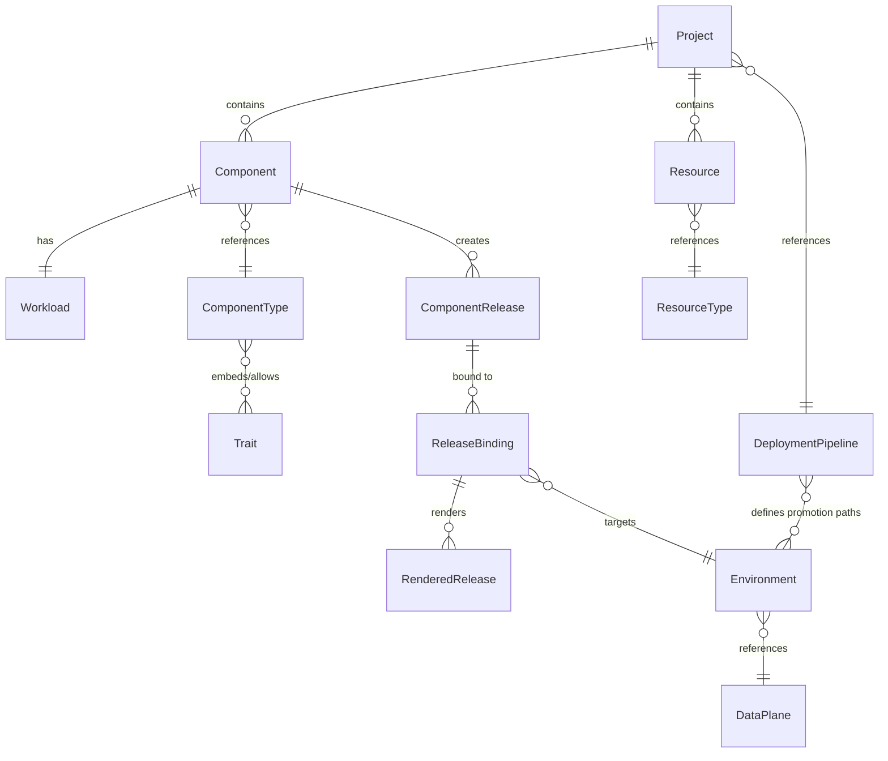

# OpenChoreo Concepts

This page explains the core concepts in OpenChoreo — what each one is, why it exists, and how they work together. For detailed API-level field definitions, see the [Resource Kind Reference Guide](resource-kind-reference-guide.md).

## Overview

OpenChoreo organizes platform concerns into two audiences:

- **Developers** work with Projects, Components, Workloads, and Releases to define what they want to run.
- **Platform engineers** define ComponentTypes, Traits, ResourceTypes, Environments, and DataPlanes to govern how things run.

The deployment flow looks like this:

```text
Developer intent                              Platform reality
─────────────────                             ─────────────────
Component + Workload
        │
        ▼
ComponentRelease  (immutable snapshot)
        │
        ▼
ReleaseBinding    (binds to an Environment)
        │
        ▼
RenderedRelease   (final K8s manifests → DataPlane)
```

## Resource Hierarchy



---

## Developer Abstractions

### Project

A **Project** is a logical grouping of related Components and Resources that collectively form an application or bounded context. It serves as the top-level organizational boundary.

**Why it exists:** Projects let you group related services together and define how they are promoted through environments. A Project references a DeploymentPipeline, which controls the promotion path (e.g., dev → staging → prod).

```yaml
apiVersion: openchoreo.dev/v1alpha1
kind: Project
metadata:
  name: online-store
spec:
  deploymentPipelineRef: default
```

**Key points:**
- All Components and Resources within a Project share the same promotion path.
- Projects are namespaced — the Kubernetes namespace acts as the organizational boundary.

---

### Component

A **Component** represents a single deployable unit of software — such as a backend service, a web frontend, a scheduled job, or an API proxy.

**Why it exists:** A Component is the primary resource developers interact with. It declares *what* you want to deploy by referencing a platform-defined template (ComponentType) and optionally attaching additional behaviors (Traits). The Component itself does not contain the container image or runtime details — those belong to the associated Workload.

```yaml
apiVersion: openchoreo.dev/v1alpha1
kind: Component
metadata:
  name: reading-list-service
spec:
  owner:
    projectName: online-store
  componentType: deployment/web-service
  autoDeploy: true
  parameters:
    replicas: 2
```

**Key points:**
- Each Component has exactly one associated Workload (one-to-one relationship).
- The `componentType` field references a ComponentType that determines the workload kind (Deployment, StatefulSet, CronJob, etc.) and the available configuration parameters.
- When `autoDeploy: true`, OpenChoreo automatically creates a ComponentRelease and ReleaseBinding whenever the Component or Workload changes.

---

### Workload

A **Workload** captures the runtime contract of a Component — how the component actually runs. This includes the container image, exposed endpoints, environment variables, mounted files, and dependencies on other services or resources.

**Why it exists:** Separating the Workload from the Component keeps identity and configuration (Component) distinct from runtime behavior (Workload). This separation enables:
- A single source codebase to back multiple Components, each with different runtime contracts.
- CI systems to update the Workload (e.g., new image tag after a build) without modifying the Component itself.
- Clear ownership: developers maintain Workloads alongside their source code, while platform engineers manage ComponentTypes.

```yaml
apiVersion: openchoreo.dev/v1alpha1
kind: Workload
metadata:
  name: reading-list-service
spec:
  owner:
    projectName: online-store
    componentName: reading-list-service
  container:
    image: registry.example.com/reading-list:v1.2.0
    env:
      - key: LOG_LEVEL
        value: info
  endpoints:
    reading-list-api:
      type: HTTP
      port: 8080
      visibility:
        - external
      basePath: /api/v1/reading-list
```

**Key points:**
- Endpoints define how the component is reachable — port, protocol (HTTP, gRPC, GraphQL, etc.), visibility (project-internal, namespace-internal, or external), and an optional API schema.
- Dependencies on other components' endpoints and on Resources are declared in `dependencies`, so OpenChoreo can wire connections automatically.

---

### ComponentRelease

A **ComponentRelease** is an immutable snapshot created when a Component is released. It freezes the ComponentType spec, all attached Traits, the developer's parameters, and the Workload spec at a specific point in time.

**Why it exists:** Immutable snapshots guarantee reproducible deployments. The same ComponentRelease can be promoted through multiple environments (dev → staging → prod) with confidence that nothing has changed since it was tested. If the Component or its Workload is updated, a *new* ComponentRelease is created — the previous one remains untouched.

**Key points:**
- All spec fields are immutable after creation (enforced by Kubernetes validation rules).
- A ComponentRelease is named `{component}-{hash}`, where the hash covers the frozen specs.
- New releases are created automatically when `autoDeploy` is enabled, or manually via CLI/API.
- The frozen snapshot includes: ComponentType spec, Trait specs, component parameters, and Workload spec.

---

### ReleaseBinding

A **ReleaseBinding** connects a ComponentRelease to a specific Environment. This is where environment-specific configuration is applied — things like production replica counts, environment-specific secrets, or different resource limits.

**Why it exists:** Environments differ in their requirements (dev might use 1 replica, prod might use 5). Rather than creating separate ComponentReleases for each environment, the ReleaseBinding lets you deploy the *same* immutable release to different environments with appropriate overrides.

```yaml
apiVersion: openchoreo.dev/v1alpha1
kind: ReleaseBinding
metadata:
  name: reading-list-service-prod
spec:
  owner:
    projectName: online-store
    componentName: reading-list-service
  environment: production
  releaseName: reading-list-service-abc123
  componentTypeEnvironmentConfigs:
    replicas: 5
  workloadOverrides:
    container:
      env:
        - key: LOG_LEVEL
          value: warn
```

**Key points:**
- Each ReleaseBinding targets one Environment and references one ComponentRelease.
- Environment-specific overrides do *not* modify the original ComponentRelease — they are applied at render time.
- The ReleaseBinding controller creates a RenderedRelease containing the final Kubernetes manifests.
- Promotion between environments means creating a new ReleaseBinding that references the same ComponentRelease in the next environment.

---

### RenderedRelease

A **RenderedRelease** contains the final Kubernetes manifests that are actually deployed to a DataPlane. It is the output of evaluating a ReleaseBinding — the ComponentType template is rendered with the frozen parameters, traits, workload spec, and environment-specific overrides.

**Why it exists:** The RenderedRelease is the point where developer intent becomes platform reality. OpenChoreo evaluates CEL template expressions, resolves connections, and produces concrete Kubernetes resources (Deployments, Services, HTTPRoutes, etc.) ready for the target cluster.

**Key points:**
- Created automatically by the ReleaseBinding controller — developers do not author these directly.
- Each rendered resource is tracked individually with health status (Healthy, Progressing, Degraded, etc.).
- Deployed to a DataPlane (the target Kubernetes cluster) via the cluster agent.

---

## Composition and Templating

These resources are typically authored by **platform engineers** to define golden paths and organizational standards.

### ComponentType / ClusterComponentType

A **ComponentType** is a platform engineer's template that defines what a component looks like and what Kubernetes resources it produces. It specifies the workload kind (Deployment, StatefulSet, CronJob, Job, or proxy), the parameters developers can configure, and the Kubernetes resource templates that get rendered at deploy time.

**Why it exists:** ComponentTypes let platform engineers encode organizational best practices into reusable templates. Developers choose a ComponentType when creating a Component, and the platform handles the rest — they never need to write raw Kubernetes manifests.

**Key points:**
- The `workloadType` field determines the primary Kubernetes resource (e.g., `deployment` → Deployment, `cronjob` → CronJob).
- Parameters use either the OpenChoreo shorthand schema (`ocSchema`) or standard OpenAPI v3 JSON Schema.
- Resource templates use `${...}` CEL expressions for dynamic values.
- Cluster-scoped variants (`ClusterComponentType`) are available across all namespaces.

---

### Trait / ClusterTrait

A **Trait** is a composable behavior that can be added to Components. Traits can create new Kubernetes resources or patch existing ones — for example, adding a sidecar container, attaching a HorizontalPodAutoscaler, or injecting monitoring annotations.

**Why it exists:** Traits let platform engineers define cross-cutting capabilities that developers can opt into, without modifying the base ComponentType. This keeps ComponentTypes focused while enabling extensibility.

**Key points:**
- Traits can `create` new resources (e.g., an HPA) or `patch` existing resources (e.g., add a container to a Deployment).
- ComponentTypes declare which Traits are embedded (always applied) and which are allowed (opt-in by developers).

---

### ResourceType / ClusterResourceType

A **ResourceType** is a platform engineer's template for provisioning managed infrastructure — databases, caches, message queues, and similar backing services.

**Why it exists:** Just as ComponentTypes abstract away Kubernetes manifests for applications, ResourceTypes abstract away the provisioning of infrastructure. Developers declare a Resource that references a ResourceType and supply parameters; the platform handles the rest.

**Key points:**
- ResourceTypes declare `outputs` (connection strings, credentials, etc.) that consumers wire into their Workloads via `dependencies.resources[]`.
- Outputs can be literal values, references to Secrets, or references to ConfigMaps on the data plane.
- Sample ResourceTypes for PostgreSQL, Valkey, and NATS ship under `samples/getting-started/cluster-resource-types/`.

---

## Platform Infrastructure

These resources define **where** and **how** workloads run. They are configured by platform engineers and SREs.

### Environment

An **Environment** represents a runtime context — such as `development`, `staging`, or `production`. It references a DataPlane (the target Kubernetes cluster) and can include environment-specific gateway configuration.

**Key points:**
- Environments are referenced by ReleaseBindings to determine where a release is deployed.
- The `isProduction` flag marks an environment as production (useful for policy enforcement).

---

### DeploymentPipeline

A **DeploymentPipeline** defines promotion paths between Environments — for example, requiring a release to be deployed to `staging` before `production`.

**Key points:**
- Projects reference a DeploymentPipeline to inherit its promotion rules.
- Promotion rules are enforced by the OpenChoreo API server; direct `kubectl` access bypasses these checks (allowing hotfixes).

---

### DataPlane / ClusterDataPlane

A **DataPlane** represents a target Kubernetes cluster where workloads are deployed. It connects to the control plane via a WebSocket-based cluster agent.

**Key points:**
- Environments reference a DataPlane to determine the target cluster.
- Each DataPlane has its own API gateway configuration and optional secret store integration.

---

## Putting It All Together

Here is the end-to-end flow from developer action to running workload:

```text
1. Platform engineer creates:
   ComponentType   ──  defines the template (e.g., web-service)
   Environment     ──  defines where to deploy (e.g., dev, prod)
   DataPlane       ──  configures the target cluster
   DeploymentPipeline  ──  defines dev → staging → prod

2. Developer creates:
   Project             ──  groups services, references pipeline
   Component           ──  "I want a web-service called reading-list"
   Workload            ──  "Here is the image, ports, and config"

3. OpenChoreo automates:
   ComponentRelease    ──  immutable snapshot of the above
   ReleaseBinding      ──  binds the release to dev environment
   RenderedRelease     ──  renders K8s manifests → deploys to DataPlane

4. Promotion:
   Same ComponentRelease  ──  new ReleaseBinding for staging
                          ──  new ReleaseBinding for production
```

For the complete API-level field definitions and all resource kinds, see the [Resource Kind Reference Guide](resource-kind-reference-guide.md).
